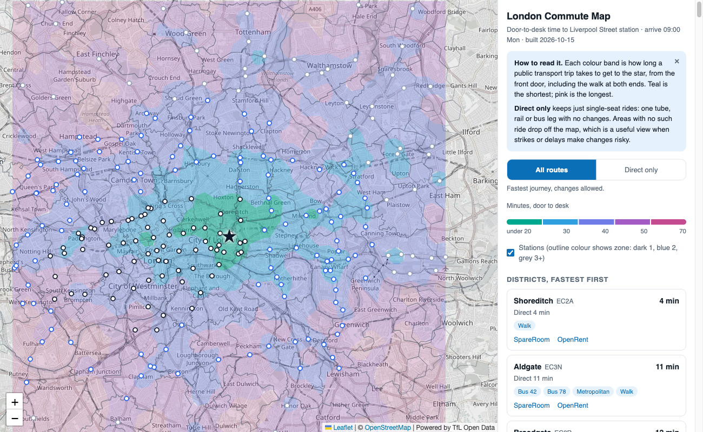

# London Commute Map

A map of how long a door-to-desk commute to Liverpool Street station takes from across London, with a direct-only view for single-seat rides.

**Live: https://london-commute-map.vercel.app**



## What the map shows

- **Colour bands** are door-to-desk public transport time to the star (Liverpool Street station), including the walk at both ends, for a journey arriving at 09:00 on a weekday. Teal is the shortest, pink the longest.
- **Direct only** recolours the map by the best single-seat ride: one tube, rail or bus leg with no changes, walking allowed at either end. Areas with no such ride are faded. It is the view to use when strikes or delays make changes risky.
- **Stations** are drawn with their TfL zone and lines.
- **Districts** are ranked by commute time, with links out to SpareRoom and OpenRent searches for that postcode district. The project holds no rent or listing data; bring your own.

There is no server. The page is `index.html` plus a pre-built `data.js`.

## How the pipeline works

`build.py` produces `data.js`. Run `uv run build.py` (dependencies are declared inline, so there is nothing to install first).

1. **H3 grid.** The bounding box in `config.py` is covered with [H3](https://h3geo.org) hexagons at resolution 8. Each hex is one sample point, taken at its centre.
2. **Journey planner sampling.** For every hex centre the script asks the TfL Journey Planner for trips to the destination, arriving at the reference time, with two preferences: least time and least interchange. Each hex stores its fastest journey overall and the lines used.
3. **Direct-only computation.** From the journeys returned for a hex, those with at most one non-walking leg count as single-seat rides. The fastest of those is the hex's direct time, and the lines used within ten minutes of it are kept as the "via" list. Hexes with no such journey have no direct time.
4. **Contours.** Hex times are rasterised to a grid, blurred slightly (skipping rivers and parks that have no data), and turned into filled bands with matplotlib. This is done once for all routes and once for direct-only.
5. **Districts and stations.** Each hex is reverse-geocoded to a postcode district with OpenStreetMap Nominatim. Districts get their median times and most common lines. District outlines come from open postcode polygons. Station names, zones and lines come from the TfL StopPoint API.
6. **Caching and resume.** Every API response is cached as a small JSON file under `cache/` (not committed). A run that is interrupted, rate limited or offline picks up where it stopped, and a re-run with warm caches takes seconds. If you change the destination or date, the cached journeys are cleared automatically.

## Rebuild for your own destination

1. Get a free TfL key at <https://api-portal.tfl.gov.uk>. An OpenRouteService key (<https://openrouteservice.org>) is optional and only adds walking times, which the map does not display.
2. Set the keys in your shell. They are read from the environment and never stored in the repo:

   ```sh
   export TFL_APP_KEY=your-tfl-key
   export ORS_API_KEY=your-ors-key   # optional
   ```

3. Edit `config.py`: `DESTINATION` (latitude, longitude, label), `BBOX` for the area, and optionally `COMMUTE_DATE` and `COMMUTE_TIME`. By default the date is the next Monday, because TfL rejects dates more than a week in the past.
4. Run `uv run build.py`. A cold build makes two TfL requests per hex, so it takes a while and is paced to stay inside TfL's rate limit; a re-run resumes from the cache.
5. Open `index.html`, or serve the folder with any static host.

## Notes and limits

- Times follow the published timetable, not strike-day reality.
- Hex centres are samples. A hex that straddles a river or park can read slightly off.
- Nominatim is used politely (about one request a second) with a descriptive User-Agent.

## Attribution

- Journey times, stations and zones: **Powered by TfL Open Data**, used under the [Open Government Licence v3.0](https://www.nationalarchives.gov.uk/doc/open-government-licence/version/3/). Contains OS data &copy; Crown copyright and database rights.
- Map data and tiles &copy; [OpenStreetMap](https://www.openstreetmap.org/copyright) contributors. Reverse geocoding by OpenStreetMap Nominatim.
- Postcode district outlines: [missinglink/uk-postcode-polygons](https://github.com/missinglink/uk-postcode-polygons).
- Map rendering: [Leaflet](https://leafletjs.com).

## Licence

MIT, see [LICENSE](LICENSE). The data sources above keep their own licences.
